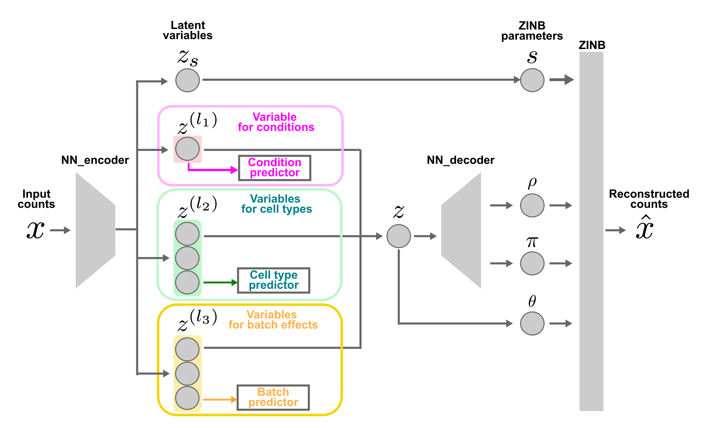
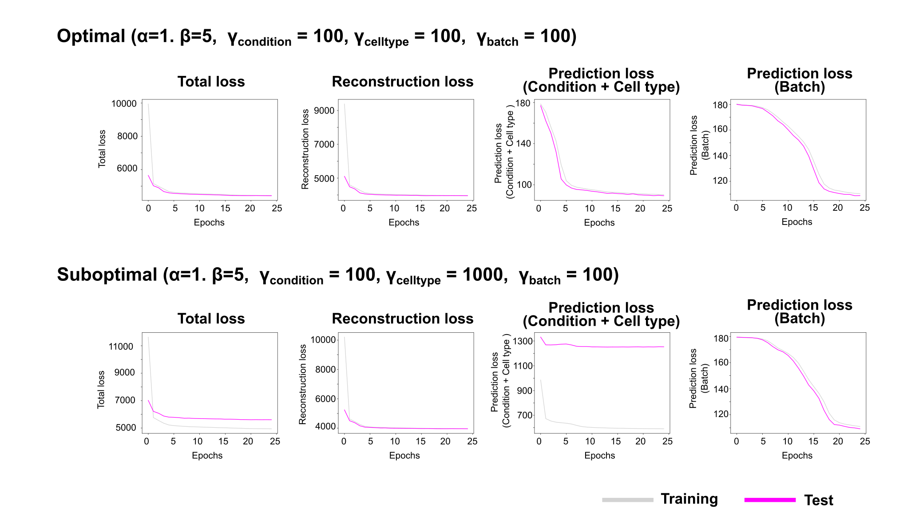

# Kanade
Kanade is a batch correction method explicitly designed to disentangle batch effects and the effects across conditions. Kanade can selectively correct the batch effects while preserving biologially meaningful conditional effects.

## Requirements / Notes

- GPU is recommended. The main tested environment is PyTorch with CUDA 12.4 (cu124).
- CPU-only usage is intended to work, but it is not fully validated yet (performance may be very slow and some configurations may fail).

## Installation

### 1. Install PyTorch

#### With GPU (Recommended)

`pip install --index-url https://download.pytorch.org/whl/cu124 torch torchvision torchaudio`

#### CPU Only (Not recommended)

`pip install torch torchvision torchaudio`

### 2. Install Kanade

`pip install "git+https://github.com/ShuntaSakaguchi/kanade.git@main"`

## FAQ

### Q. Can we use Kanade without GPUs?

A. Kanade can be used in CPU-only environments. However, this mode has not been tested and is not recommended.

### Q. How can we decide dimensionality of each latent variables?

A. When the number of latent dimensions is excessive, uninformative latent variables tend to emerge. These variables can be identified because their posterior distributions approach the prior distribution, namely a normal distribution with mean 0 and variance 1. Thus, one practical strategy is to first train the model with a relatively large number of latent dimensions and then refine the model by removing such redundant dimensions.

### Q. How can we decide loss function weights?

A. When the weights of the loss-function terms are inappropriate, some terms may fail to learn, whereas others may be learned too rapidly and become strongly overfitted, as reflected by a large discrepancy between training and test scores. Therefore, it is desirable to select hyperparameters that minimize such discrepancies (see the figure). We are also considering adding a function to plot diagnostic figures for this purpose in a future update.

## Citation
If you use Kanade in your work, please cite this bioRxiv preprint.

Shunta Sakaguchi, Masato Tsutsumi, Kentaro Nishi Honda Naoki, Disentanglement of batch effects and biological signals across conditions in the single-cell transcriptome, bioRxiv, 2025 [link](https://www.biorxiv.org/content/10.1101/2025.04.10.648296v1)
